# x12-837-phi-obfuscator

[](https://github.com/david-axelrod-tech/x12-837-phi-obfuscator/actions/workflows/ci.yml)


[](LICENSE)

Strip Protected Health Information (PHI) out of **ANSI X12 837 claim files** (837P
professional and 837I institutional) while leaving every other byte exactly where it was,
so the output still validates, still loads into a clearinghouse or test system, and still
looks like a real claim batch.

Three levels of de-identification, one command (or one window):

| Mode | What it is for | Standard |
|---|---|---|
| `basic` | Realistic **test data**. Patient identity is replaced; service dates, claim numbers, providers and ZIPs are kept so the file behaves identically in a test system. | - |
| `expert` | The usual input for an **Expert Determination**. Basic, plus shifted dates, scrambled claim/line/auth numbers, renamed NPI-less providers, 3-digit ZIP. Pseudonyms are a keyed hash so the same patient maps the same way across files and runs. | 45 CFR 164.514(b)(1) |
| `safe-harbor` | **HIPAA Safe Harbor** applied literally: all 18 identifier classes handled, year-only dates, ages over 89 collapsed, free text redacted, random (not derived) pseudonyms. | 45 CFR 164.514(b)(2) |

## Why this exists

RCM, EDI and integration teams constantly need real-shaped 837 files: to reproduce a payer
rejection, to load a test clearinghouse, to train staff, to hand a sample to a vendor.
Production claims are full of PHI, and the usual answers (hand-edit a file, regex-replace a
few names, or write a throw-away script) break the file, miss identifiers hiding in notes
and `REF` segments, or produce something no compliance officer will sign off on.

This tool is the answer I wanted on hand: a single standard-library Python file that an
analyst can double-click, that knows where PHI lives in an 837, that proves what it
changed, and that explains the regulatory basis for each choice.

## Quick start

```bash
# realistic test data from a folder of claims (layout reproduced under ./scrubbed)
python obfuscate_837.py ./837_files -o ./scrubbed

# expert-determination input; the seed is the hash key, keep it secret
python obfuscate_837.py ./837_files -o ./expert --mode expert --seed "my secret"

# Safe Harbor; the mapping CSV is the re-identification key under 164.514(c)
python obfuscate_837.py ./837_files -o ./deid --mode safe-harbor --map key.csv

# overwrite in place, writing *_scrubbed copies beside the originals
python obfuscate_837.py claim.dat --in-place --suffix _scrubbed
```

Run with **no arguments** (or double-click `obfuscate_837.pyw` on Windows) and a window
opens with the same choices, a progress bar and a live log. Dropping a file or folder onto
the icon opens the window pre-filled. Run `-h` for the full option list and a
side-by-side table of what each mode changes.

Try it on the included synthetic sample:

```bash
python obfuscate_837.py samples/sample_837p.x12 -o out --mode expert --seed demo
```

## Before and after (expert mode, synthetic data)

```text
NM1*IL*1*DOE*JANE*Q***MI*ZZ12345A~            NM1*IL*1*ANDREWS*ROXANNE*V***MI*LP79399B~
N3*123 MAPLE ST*APT 4~                        N3*2218 ALDER LN*APT 914~
N4*SPRINGDALE*NY*12345~                       N4*GRANITE FALLS*NY*12300~
DMG*D8*19500614*F~                            DMG*D8*19490430*F~
REF*SY*123456789~                             REF*SY*185377865~
CLM*37-104625*480.00***12:B:1*Y*A*Y*Y~        CLM*37-525651*480.00***12:B:1*Y*A*Y*Y~
DTP*434*RD8*20250203-20250207~                DTP*434*RD8*20250124-20250128~
REF*EA*MRN0004471~                            REF*EA*XNA2629797~
NTE*ADD*NAME: JOHN DOE REL: SPOUSE ...~       NTE*ADD*NAME: LULA AUSTIN REL: SPOUSE ...~
HI*ABK:I10*ABF:E119~                          HI*ABK:I10*ABF:E119~          (unchanged)
NM1*82*1*SMITH*MARY****XX*1888888886~         NM1*82*1*SMITH*MARY****XX*1888888886~  (NPI provider: unchanged)
SV1*HC:T1019:U1*120.00*UN*4***1~              SV1*HC:T1019:U1*120.00*UN*4***1~       (unchanged)
```

Every replacement keeps the **shape** of the original (length, letter/digit pattern, date
format, office prefix on account numbers), so segment counts, control totals and payer
edits are unaffected.

## What each mode changes

```text
                               basic           expert           safe-harbor
  patient / subscriber names   fake            fake             fake
  member ID, MRN, SSN          pseudonym       pseudonym        random
  street, city, county         fake / dropped  fake / dropped   fake / dropped
  state                        kept            kept             kept
  ZIP                          kept            first 3 digits   first 3 digits*
  date of birth                shifted +-2 yr  shifted +-2 yr   year, 90+ cap
  service / admit / stmt dates kept            shifted 1..N d   year only
  envelope dates (ISA/GS/BHT)  kept            kept             year only
  CLM01, line/auth/trace/PWK # kept            pseudonym **     random
  NPI-less person providers    kept            fake             fake
  NTE / K3 free text           names scrubbed  names scrubbed   REDACTED
  group number (SBR03)         kept ***        kept ***         random
  gender, dx/px codes, charges, NPIs, provider orgs, payers: kept in every mode

    *  000 for the HHS restricted 3-digit ZIP areas (< 20,000 people)
    ** office prefix before the hyphen is kept, e.g. 37-104625 -> 37-684996
    *** replaced only when it repeats the member ID
```

Fine-tuning flags (`--shift-service-dates`, `--date-shift-days N`, `--scramble-claim-ids`,
`--scramble-provider-names`, `--zip-mode keep|zip3|random`, `--id-keep-tail N`) let you
turn individual expert-mode behaviours on in basic mode. Safe Harbor ignores them all, by
design.

## Architecture

```mermaid
flowchart LR
    A["Input files / folders"] --> B["collect_inputs<br/>walk dirs, skip non-ISA files"]
    B --> C["Read bytes, decode latin-1<br/>(byte-preserving)"]
    C --> D["X12Delims<br/>element / repetition / component / segment<br/>separators from ISA positions 4, 83, 105, 106"]
    D --> E["split_segments<br/>lossless: keeps whitespace, line endings,<br/>trailing remainder"]
    E --> F["Pass 1: scan NM1<br/>collect patient and relative name tokens,<br/>all member IDs"]
    F --> G["Pass 2: HL state machine<br/>HL*20 billing: pass through<br/>HL*22 / *23: route each segment to seg_&lt;TAG&gt; handler"]
    G --> H["Scrambler<br/>basic / expert: HMAC-SHA256(seed, category, value)<br/>safe-harbor: os.urandom<br/>same-shape replacement, (category, real) -> fake table"]
    H --> I["Re-join with original delimiters"]
    I --> J["Leak check<br/>position-by-position diff of every<br/>patient element; exit 2 if any survived"]
    J --> K["Write output<br/>+ optional mapping CSV"]
```



### 837 loop coverage

| Loop | Segments | basic | expert | safe-harbor |
|---|---|---|---|---|
| ISA / GS / ST / BHT envelope | control numbers, dates | kept | kept | dates reduced to year |
| 1000A / 1000B submitter, receiver | NM1, PER | kept | kept | kept |
| 2000A / 2010AA / 2010AB billing, pay-to provider | NM1, N3, N4, REF EI | kept | kept | kept |
| 2010BB payer | NM1 PR, N3, N4 | kept | kept | kept |
| 2000B / 2010BA subscriber | NM1 IL, N3, N4, DMG, REF SY/EA, PER | replaced | replaced | replaced, DOB year only |
| 2000B SBR | SBR03 group number | replaced only if it repeats the member ID | same | always replaced |
| 2000C / 2010CA patient (dependent) | NM1 QC, N3, N4, DMG, REF, PER | replaced | replaced | replaced, DOB year only |
| 2300 claim | CLM01, DTP, HI dates, REF 6R/G1/9F/F8/D9, PWK06 | kept | pseudonym / shifted | random / year only |
| 2300 free text | NTE, K3 | names and 5+ digit runs scrubbed | same | `REDACTED` |
| 2310 / 2420 providers with an NPI | NM1 ... XX | kept | kept | kept |
| 2310 / 2420 person providers without an NPI | NM1 (aides, family caregivers) | kept | renamed | renamed |
| 2310E / 2310F ambulance pick-up, drop-off | NM1 PW / 45, N3, N4 | address replaced | same | same |
| 2310C service facility without an NPI | NM1 77, N3, N4 | address replaced (patient's home) | same | same |
| 2320 / 2330A other subscriber | SBR, NM1 IL | replaced | replaced | replaced |
| 2400 service lines | SV1 / SV2, DTP 472, REF 6R, NTE | codes and charges kept; dates and line IDs per mode | same | same |
| SE / GE / IEA trailers | counts | kept | kept | kept |

The same handlers serve 837P (005010X222A1) and 837I (005010X223A2); institutional-only
segments such as CL1 and the HI occurrence and span dates are covered by the generic date
rules.

## Design notes

**Delimiter-preserving parser.** The file is split on the terminators declared in the ISA
header and re-joined with the original whitespace, line endings and trailing separators.
Nothing is re-serialised, so a file that round-trips through the tool with no PHI in it
comes out byte-identical.

**Context-aware, not regex-based.** Transformations only fire inside the subscriber /
patient hierarchy (`HL*..*22` and `*23`). The billing provider's address, the payer, the
submitter and every entity carrying an NPI are never touched. Address segments are only
scrubbed when they follow a patient, ambulance pick-up/drop-off, or NPI-less facility
`NM1` (a service facility without an NPI in home care is the patient's home).

**Keyed pseudonyms (basic / expert).** Each fake value is derived from
`HMAC-SHA256(seed, category || real)`, so the same real patient gets the same fake
identity in every file and every run that shares a seed, with no mapping table to protect.
HHS permits this under Expert Determination provided the key is not disclosed.

**Random pseudonyms (safe-harbor).** HHS treats any code derived from PHI, including an
unkeyed hash, as an identifier. Safe Harbor mode therefore draws from `os.urandom` and
offers `--map` / `--map-in` for the (rare) case where cross-run consistency is needed.

**Two name tables.** Patients and everyone else (relatives named in `NTE` notes, aides,
contact persons) draw from separate pools, so a spouse who really shares the patient's
surname never shares the patient's *fake* surname, and a note can never leak the fake
patient's name. Free-text scrubbing understands the common `NAME: ... REL: ...` pattern.

**Per-patient date shifting.** One offset per patient (keyed on name + DOB, not member ID,
so a patient billed to two payers shifts consistently) is applied to every `DTP`, `HI`
occurrence/span date and `PAT` date, preserving intervals within a claim. DOBs are
clamped so no fake age exceeds 89.

**Built-in leak check.** After writing, every patient element the tool is responsible for
is compared position-by-position against the input. Anything that survived unchanged is
reported with its segment number and the process exits with status 2.

**Payer quirks handled.** `SBR03` repeating the member ID (Indiana Medicaid), fixed member
ID tails (`--id-keep-tail 2` for IHCP RIDs ending in 99), member IDs with plan suffixes
(`1234/CHOICE`), `<office>-<sequence>` account numbers.

## Edge cases

| Situation | Behaviour |
|---|---|
| File does not start with a 106-byte ISA | Skipped and counted, never rewritten. A directory of mixed files is safe to point at. |
| Non-standard element, component, repetition or segment separators | Read from the ISA header; nothing is hard-coded to `*`, `:` or `~`. |
| Line endings, blank lines or whitespace between segments; trailing bytes after the last terminator | Captured as a prefix per segment and a remainder, written back unchanged. |
| Segments padded with trailing empty elements | `_trim` never drops below the original element count, so `NM1*IL*1*DOE*JANE****MI*123~` keeps its shape. |
| Bytes outside UTF-8 | File is read and written as latin-1, so every byte value round-trips; untouched content is byte-identical. |
| Patient billed to two payers, or appearing in several files | Date offset and fake DOB are keyed on name + DOB, not member ID, so they agree everywhere. |
| Member ID with a plan suffix (`1234/CHOICE`) or a fixed payer tail (`...99`) | Core is pseudonymised, suffix kept; `--id-keep-tail N` preserves the tail. |
| SBR03 repeating the member ID (Indiana Medicaid) | Replaced with the same fake the NM109 gets, so the file stays internally consistent. |
| Account numbers of the form `<office>-<sequence>` | Office prefix kept, sequence replaced. |
| Service facility (NM1 77) without an NPI | Treated as the patient's home: address replaced. With an NPI it is a real facility and is kept. |
| Date value not in D8 / RD8 / DT / D6 shape | Left unchanged rather than corrupted; the leak check still flags an unchanged DOB. |
| Shifted DOB would land in the future, or fake age would exceed 89 | Clamped to the past and to 89 years. |
| Fake name pool contains the real name | `_pick` never returns the real value. |
| A note ends up containing the fake patient's full name | Rewritten with a different first name (belt and braces). |
| `-o` resolves to the input file | Refused with an error; use `--in-place` explicitly. |
| Any patient element survives unchanged | Reported with its segment number; process exits 2. |
| stdout is a closed pipe (`| head`) | Run continues; files are still written. |

## Options

```text
usage: obfuscate_837.py INPUT [INPUT ...] (-o OUTDIR | --in-place) [options]

output:
  -o, --out OUTDIR          write results under OUTDIR, keeping the input folder layout
  --in-place                overwrite the input files (or, with --suffix, write beside them)
  --suffix SFX              insert SFX before the file extension, e.g. _scrubbed
  -q, --quiet               print only warnings and errors

mode:
  --mode basic|expert|safe-harbor
  --seed SECRET             key for the pseudonym hash (basic and expert)

fine-tuning (expert turns the first three on; safe-harbor ignores all of them):
  --shift-service-dates     shift every claim date back 1..N days, one offset per patient
  --scramble-claim-ids      replace CLM01, line control, prior-auth, referral, payer claim
                            control, trace and attachment numbers
  --scramble-provider-names rename person providers that have no NPI
  --date-shift-days N       window for the date shift (default 60)
  --zip-mode keep|zip3|random
  --id-keep-tail N          keep the last N characters of member IDs

mapping:
  --map CSV                 write the real -> fake table (contains PHI)
  --map-in CSV              load a table written by --map so this run reuses the same fakes

exit status: 0 done, 1 nothing written, 2 leak check found an unchanged patient element
```

## Building a stand-alone Windows executable

```bash
pip install pyinstaller
pyinstaller --onefile --windowed --name obfuscate_837 obfuscate_837.pyw
```

The resulting `dist/obfuscate_837.exe` needs no Python install and opens the GUI on
double-click. Attach it to a GitHub Release rather than committing it.

## Tests

```bash
python -m unittest discover -s tests -v
```

The suite runs every mode against the synthetic sample in `samples/` and checks structure
preservation, shape-preserving replacement, determinism, leak detection, date-shift
consistency, Safe Harbor year-only dates and mapping round-trips.

## Compliance notes

- This tool applies de-identification **techniques**. Only a qualified expert's written
  determination makes a data set de-identified under 164.514(b)(1), and Safe Harbor
  additionally requires that the covered entity has **no actual knowledge** that the
  remaining data (diagnosis codes, NPIs, state, year, charges) could identify someone
  (164.514(b)(2)(ii)). Review the output before releasing it.
- The `--seed` (expert) and the `--map` file (safe-harbor) are re-identification keys.
  Keep them inside the covered entity.
- The restricted 3-digit ZIP list is the one published by HHS OCR from the 2000 Census.
  Check hhs.gov for a newer list before relying on it.
- Nothing here is legal advice.

## Requirements

Python 3.9 or newer. Standard library only; `tkinter` ships with the standard Windows and
macOS installers. Optional: `pip install tkinterdnd2` enables drag-and-drop into the
window.

## License

MIT. See [LICENSE](LICENSE).

## Author

David Axelrod. Healthcare revenue-cycle and EDI technology.
[LinkedIn](https://www.linkedin.com/in/david-axelrod-tech/)
